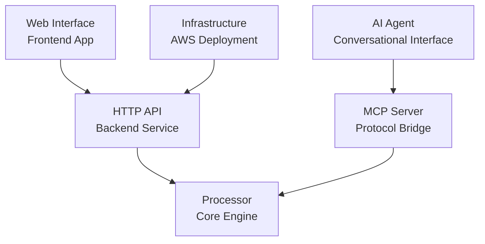

# Metadata Harmonization Platform

This sample demonstrates an end-to-end pipeline for validating, correcting, and harmonizing inconsistent CSV metadata against a target JSON schema. Upload a CSV, select a schema, and the platform automatically aligns columns and detects and corrects invalid enum values, misaligned column names, and structural mismatches, using a mix of AI techniques: fuzzy matching, embedding-based semantic similarity, contextual inference, and LLM-assisted resolution (Amazon Bedrock).

It includes a FastAPI backend that exposes both a REST API and a Model Context Protocol (MCP) server, a Next.js web UI for interactive review, and a conversational AI agent, built with the AWS Strands Agents SDK, that can drive the same validation and correction workflow through natural language over MCP. The full stack deploys via AWS CDK: VPC, a private Application Load Balancer behind CloudFront with WAF, Cognito authentication, DynamoDB, S3, and ECS Fargate. It can be used as a reference architecture for teams building their own metadata-quality or data-harmonization tooling on AWS.

**Key capabilities:**

- **Schema alignment** - Automatic column-to-schema mapping via Amazon Bedrock with rule-based fallback
- **Validation** - Cell-level checks against schema rules (enums, regex patterns, required fields)
- **AI-powered corrections** - Fuzzy matching, semantic search embeddings, contextual inference, and LLM-assisted resolution suggest and apply fixes
- **Conversational agent** - A Strands-based AI agent can drive the same validation and correction workflow through natural language over MCP
- **Schema-agnostic** - Add a JSON schema to `data/schema/` and it works out of the box

## Security Disclaimer

This solution is provided as a proof-of-value and is not intended as a production-ready implementation. You are responsible for evaluating how the AWS Shared Responsibility Model applies to your specific use case and for implementing the necessary security controls to meet your organization's requirements. AWS provides a broad set of security tools and configurations to support your security objectives, and it is your responsibility as the developer to ensure all aspects of your application are appropriately secured for production use.

## Quick Start

### Prerequisites

Ensure you have the following installed:

```bash
node -v          # 18 or higher required
python --version # 3.11 or higher required
aws --version    # AWS CLI configured with credentials
```

### Installation

```bash
git clone <repository-url>
cd metadata-harmonization

# Create and activate Python virtual environment
make createPythonEnvironment
source .venv/bin/activate

# Install all dependencies
make install
```

### Configuration

The platform requires AWS infrastructure (DynamoDB, S3, Cognito). Configure before deploying:

```bash
# Create configuration file from template
cp config.yaml.example config.yaml
```

Edit `config.yaml` with your AWS account details:

```yaml
env: "dev"  # Points to dev section below

dev:
  profile: "your-aws-profile-name"        # AWS CLI profile name
  deploymentName: "metadata-harmonization-dev"
  accountNumber: "123456789012"           # Your 12-digit AWS account
  region: "us-east-1"                     # Preferred AWS region
  deploymentStage: "dev"
  removalPolicy: "destroy"
```

### Deploy Infrastructure

```bash
# First-time setup: prepare AWS account for CDK
make bootstrap

# Deploy AWS resources
make deploy
```

This provisions DynamoDB tables, S3 buckets, Cognito user pools, ECS clusters, and other required infrastructure.

### Create Cognito Users

After deployment, create users in the Cognito user pool so they can log in to the platform:

1. Open the [Amazon Cognito console](https://console.aws.amazon.com/cognito/v2/idp/user-pools)
2. Select the user pool created by the deployment (e.g. `metadata-harmonization-users`)
3. Go to **Users** and click **Create user**
4. Enter the user's email address and a temporary password
5. Click **Create user**

The user will be prompted to set a permanent password on first login.

### Run Locally

```bash
# Run both API and frontend together (recommended)
make runLocal

# Or run components separately
make runApiLocal   # Terminal 1: API server
make runUiLocal    # Terminal 2: Frontend application
```

Access the platform:
- **Web Interface**: http://localhost:3000
- **API Documentation**: http://localhost:8080/api/docs

## System Components



## Projects

| Project | Description | Documentation |
|---------|-------------|---------------|
| **[frontend](projects/frontend/)** | Next.js/Material UI web interface with interactive spreadsheet editor | [README](projects/frontend/README.md) |
| **[api](projects/api/)** | FastAPI backend exposing validation endpoints and MCP server | [README](projects/api/README.md) |
| **[metadata-harmonization-processor](projects/metadata-harmonization-processor/)** | Core Python package for metadata validation and harmonization | [README](projects/metadata-harmonization-processor/README.md) |
| **[agent](projects/agent/)** | Conversational AI agent interface using AWS Strands | [README](projects/agent/README.md) |
| **[eval](projects/eval/)** | Evaluation framework for benchmarking accuracy and cost | [README](projects/eval/README.md) |
| **[infra](projects/infra/)** | AWS CDK infrastructure definitions for deployment | [README](projects/infra/README.md) |


## Key Makefile Commands

All commands that interact with AWS read from `config.yaml` (loaded via `loadEnvironmentVariables`). You can override any config value by passing it as a Make variable, e.g. `make deploy PROFILE=my-profile REGION=us-west-2`.

### Development

| Command | Flags | Description |
|---------|-------|-------------|
| `make install` | -- | Install all Python and TypeScript dependencies |
| `make createPythonEnvironment` | -- | Create `.venv` virtual environment via `uv` |
| `make runLocal` | -- | Start API + frontend together (synchronized shutdown) |
| `make runApiLocal` | `ENABLE_AUTH=true\|false` | Start API server only (auth disabled by default) |
| `make runUiLocal` | `STACK_NAME=<name>` | Start frontend only (generates `env.js` from stack outputs) |
| `make clean` | -- | Remove all build artifacts (Python, TypeScript, CDK, misc) |

### Testing

| Command | Flags | Description |
|---------|-------|-------------|
| `make testAll` | -- | Run all 5 test suites with combined summary |
| `make testProcessor` | -- | Test metadata processing pipeline |
| `make testApi` | -- | Test API endpoints and MCP server |
| `make testFrontend` | -- | Test React components and UI |
| `make testEval` | -- | Test evaluation system |
| `make testInfrastructure` | -- | Test CDK infrastructure |

### Evaluation and Tools

| Command | Flags | Description |
|---------|-------|-------------|
| `make runEval` | `PATH_OR_FILTER=<path\|dir\|pattern>`, `ARGS="..."` | Run evaluation on file, directory, or error rate filter (e.g. `err40`) |


### Deployment (requires `config.yaml`)

| Command | Flags | Description |
|---------|-------|-------------|
| `make bootstrap` | `PROFILE`, `ACCOUNT_NUMBER`, `REGION` | First-time CDK bootstrap (run once per AWS account/region) |
| `make deploy` | `PROFILE`, `STACK_NAME`, all config vars | Deploy all AWS infrastructure (interactive confirmation) |
| `make destroy` | `PROFILE`, all config vars | Tear down all AWS resources (interactive confirmation) |
| `make verifyDeployment` | `PROFILE` | Run deployment verification checks |
| `make createLocalDotEnvFile` | `PROFILE`, `STACK_NAME` | Generate `.env` file from deployed stack outputs |

#### Config Variables (from `config.yaml` or overridable)

| Variable | Source | Description |
|----------|--------|-------------|
| `ENV` | `config.yaml` | Active environment name (e.g. `dev`, `prod`) |
| `PROFILE` | `config.yaml` or CLI | AWS CLI profile name |
| `DEPLOYMENT_NAME` | `config.yaml` or CLI | Stack name prefix |
| `ACCOUNT_NUMBER` | `config.yaml` or CLI | 12-digit AWS account number |
| `REGION` | `config.yaml` or CLI | AWS region (e.g. `us-east-1`) |
| `DEPLOYMENT_STAGE` | `config.yaml` | CDK deployment stage |
| `TARGET_PLATFORM` | `config.yaml` | Docker platform target (e.g. `linux/amd64`) |

## Documentation

**Start here**: [Documentation Index](./docs/INDEX.md)

### Getting Started
- [Architecture Overview](./docs/getting-started/architecture-overview.md) - System design and component interactions

### Developer Guides
- [Schema Management](./docs/developer-guides/schema-management.md) - Working with schemas and validation rules

### Deployment
- [Deployment Guide](./docs/deployment/deployment-guide.md) - AWS infrastructure deployment
- [Configuration](./docs/deployment/configuration.md) - Environment and configuration management
- [Troubleshooting](./docs/deployment/troubleshooting.md) - Common issues and solutions
- [Production Considerations](./docs/security/production-considerations.md) - Security controls to enable before a real deployment

### Architecture
- [Data Flow](./docs/architecture/DataFlow.md) - How data flows through the system

## Project Structure

```
metadata-harmonization/
├── projects/
│   ├── frontend/                          # React/Next.js web interface
│   │   ├── components/metadata/          # Core UI components
│   │   ├── pages/                        # App pages and routing
│   │   └── lib/                          # Utilities and types
│   ├── metadata-harmonization-processor/  # Python processing engine
│   │   ├── src/metadata_harmonization_processor/  # Main package
│   │   ├── examples/                     # Usage examples
│   │   └── tests/                        # Test suites
│   ├── api/                              # FastAPI backend service
│   │   ├── src/metadata_harmonization_api/  # API implementation
│   │   └── tests/                        # API tests
│   ├── agent/                            # Conversational AI agent
│   │   ├── agent/                        # Agent implementation
│   │   └── test_data/                    # Demo datasets
│   ├── eval/                             # Evaluation and benchmarking
│   │   ├── src/metadata_harmonization_eval/  # Eval implementation
│   │   └── tests/                        # Eval tests
│   ├── infra/                            # AWS infrastructure code
│   │   ├── lib/                          # CDK constructs
│   │   └── bin/                          # Deployment scripts

├── docs/                                 # Documentation
│   ├── INDEX.md                          # Documentation index
│   ├── getting-started/                  # Onboarding guides
│   ├── developer-guides/                 # Technical guides
│   ├── deployment/                       # Deployment docs
│   └── architecture/                     # Architecture docs
├── data/
│   └── schema/                           # JSON schema definitions
├── Makefile                              # Development automation
└── config.yaml                           # Deployment configuration
```
