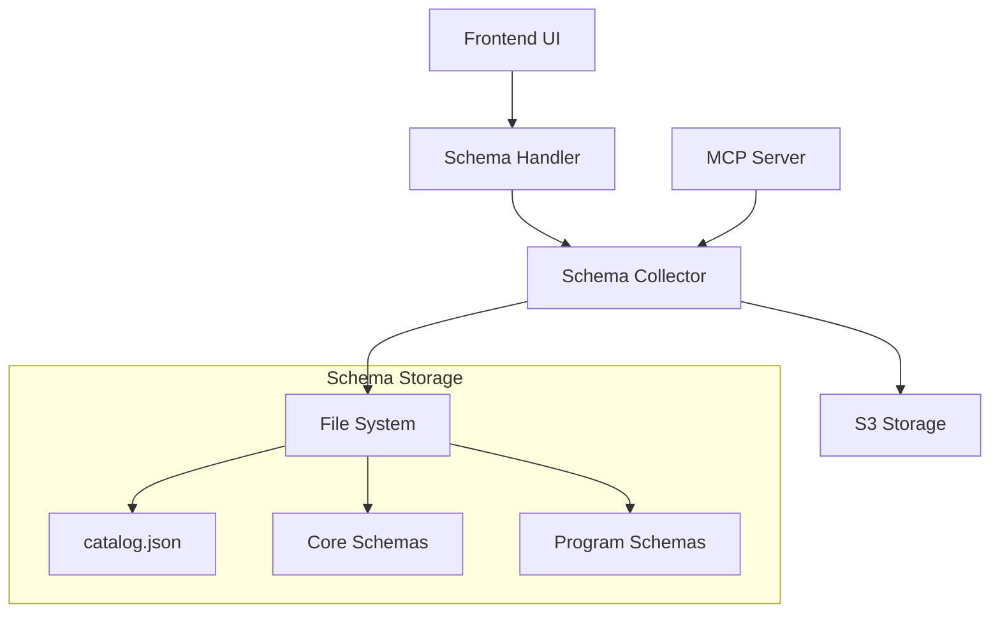

# Schema Management System

The Metadata Harmonization Platform includes a comprehensive schema management system that handles the discovery, loading, and organization of metadata validation schemas.

## Architecture Overview

The schema management system consists of several key components:



## Components

### SchemaHandler (API Layer)

**Location**: `projects/api/src/metadata_harmonization_api/api/v1/handlers/schema_handler.py`

The SchemaHandler provides the business logic layer for schema operations in the REST API, handling HTTP requests, data transformation, error handling, and logging.

#### Key Methods

```python
async def get_available_schemas(self, request: Request) -> List[SchemaInfo]:
    """
    Get all available schemas for UI selection.

    Returns:
        List of SchemaInfo objects with core and program schema information
    """
```

#### Response Format

```json
[
  {
    "coreSchemaId": "f2433d87-1984-423e-8a29-5f356cfb8c71",
    "name": "Water Quality Core",
    "coreSchemaPath": "water_quality_core_json_schema.json",
    "coreSchemaS3Bucket": "metadata-schemas",
    "programSchemas": [
      {
        "programName": "Water Quality Program",
        "s3Location": "water_quality_program_json_schema.json",
        "s3Bucket": "metadata-schemas",
        "programSchemaId": "887f963b-ffea-4f3d-b2b3-9782a97066dc"
      }
    ]
  }
]
```

### SchemaCollector (Interface Layer)

**Location**: `projects/metadata-harmonization-processor/src/metadata_harmonization_processor/interfaces/schema_collector.py`

The SchemaCollector interface defines the contract for schema discovery and loading:

```python
async def get_available_schemas(self) -> List[SchemaInfo]:
    """Get all available schema combinations."""

async def get_core_schema(self, core_id: str) -> Dict[str, Any]:
    """Load a specific core schema by ID."""

async def get_program_schema(self, program_id: str) -> Dict[str, Any]:
    """Load a specific program schema by ID."""
```

### FileBasedSchemaCollector (Implementation)

**Location**: `projects/metadata-harmonization-processor/src/metadata_harmonization_processor/implementations/file_schema_collector.py`

The file-based implementation reads schemas from the local filesystem or mounted storage with configurable directory containing `catalog.json` and schema files.

#### Catalog Structure

The `catalog.json` file defines the available schema combinations:

```json
[
  {
    "core_uuid": "f2433d87-1984-423e-8a29-5f356cfb8c71",
    "core_path": "water_quality_core_json_schema.json",
    "core_name": "Water Quality Core",
    "program": [
      {
        "program_uuid": "887f963b-ffea-4f3d-b2b3-9782a97066dc",
        "program_path": "water_quality_program_json_schema.json",
        "program_name": "Water Quality Program"
      }
    ]
  }
]
```

## API Endpoints

### GET /api/v1/metadata/schema

Returns all available schemas for validation with their associated program schemas.

**Request**:
```bash
curl http://localhost:8080/api/v1/metadata/schema
```

**Response**:
```json
[
  {
    "coreSchemaId": "uuid",
    "name": "Schema Name",
    "coreSchemaPath": "schema.json",
    "coreSchemaS3Bucket": "bucket-name",
    "programSchemas": [...]
  }
]
```

**Error Responses**:
- `500 Internal Server Error`: Schema loading failure
- `503 Service Unavailable`: Schema collector unavailable

## Integration with Dependency Management

The schema management system uses shared dependency injection for consistency between REST API and MCP server operations, ensuring both interfaces use identical schema data and configuration with internal caching to prevent duplicate file I/O.

## Configuration

### Environment Variables
```bash
# Schema directory (relative to API project root)
PROCESSOR_SCHEMA_DIRECTORY=./data/schema

# For cloud deployments
SCHEMA_BUCKET=metadata-schemas-bucket
```

### Local Development Setup
```bash
# Schema files location
projects/api/data/schema/
├── catalog.json                          # Schema catalog
├── water_quality_core_json_schema.json     # Core schema
├── water_quality_program_json_schema.json  # Program schema
└── test_schema.json                      # Additional schemas
```

### Cloud Deployment
In cloud deployments, schemas are stored in S3 and mounted to the container:
- **S3 Bucket**: Configured via `SCHEMA_BUCKET` environment variable
- **Container Mount**: Schemas mounted to `/app/schema/data/`
- **Access**: ECS task role provides S3 read permissions

## Error Handling

The schema management system handles common error scenarios:

1. **Missing Catalog**: `catalog.json` file not found
2. **Invalid Catalog**: Malformed JSON in catalog file
3. **Missing Schema Files**: Referenced schema files not found
4. **Invalid Schema**: JSON Schema validation errors
5. **Permission Errors**: Insufficient file system or S3 permissions

The system provides graceful degradation with detailed logging and appropriate HTTP status codes for different error types.
