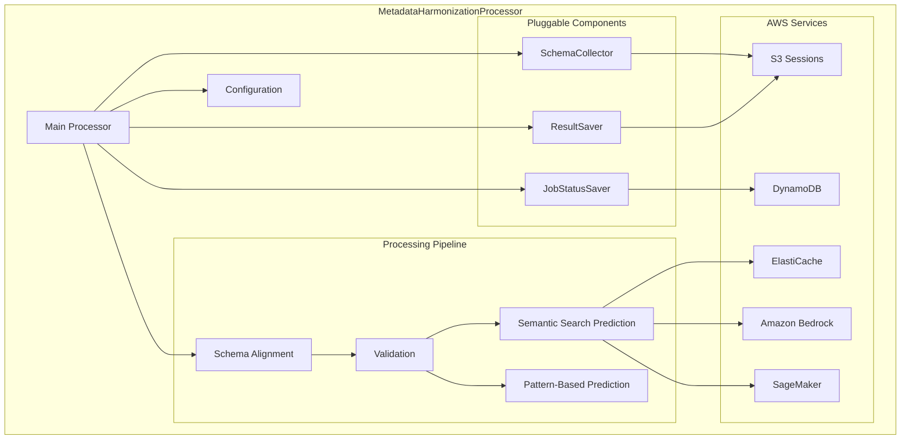

# Metadata Harmonization Processor

Standalone Python package providing schema alignment, validation, and AI-powered prediction for metadata harmonization workflows with AWS Strands integration.

## Quick Start

**Prerequisites**: Python 3.9+

```bash
# Install
cd projects/metadata-harmonization-processor
pip install -e .

# Configure
cp examples/config-local.yaml config.yaml
```

**Basic Usage**:
```python
from metadata_harmonization_processor import MetadataHarmonizationProcessor
from metadata_harmonization_processor.config import load_processor_settings

config = load_processor_settings("config.yaml")
processor = MetadataHarmonizationProcessor(config=config, session_id="demo")
results = await processor.process(metadata_df, program_id="prog", core_id="core")
```

## Pipeline Overview

The processor executes a four-stage pipeline with AWS Strands orchestration:

1. **Schema Alignment**: Maps input columns to target schema using LLM-enhanced semantic matching with detailed change tracking
2. **Validation**: Validates data against schema rules (required fields, valid options, regex patterns) with custom error messages
3. **Semantic Prediction**: AI-powered recommendations for invalid options using Amazon Bedrock/SageMaker embeddings
4. **Pattern Prediction**: Heuristic corrections for dates, numbers, emails, phone numbers, and missing required values

Each stage is implemented as an AWS Strands MultiAgentBase node. Semantic and pattern prediction run in parallel for optimal performance. The pipeline produces comprehensive validation results with AI-powered recommendations and detailed transformation tracking.



## Configuration

The processor supports local and production configurations through YAML files:

| Config Section | Local Development | Production |
|---|---|---|
| Job Status | `local` (file-based) | `dynamodb` (DynamoDB table) |
| Result Storage | `local` (./data/validation-results) | `s3` (S3 bucket with versioning) |
| Caching | `memory` (in-memory only) | `redis` (ElastiCache cluster) |
| AI Models | Optional (pattern-only mode) | `bedrock` or `sagemaker` |
| Schema Source | `file` (local catalog.json) | `file` or custom SchemaCollector |

**Local Config Example**:
```yaml
job_status_saver_type: "local"
job_status_storage_dir: "./data/job_status"
result_saver_type: "local"
results_local_dir: "./data/validation-results"
enable_redis_cache: false
enable_memory_cache: true
```

**Production Config Example**:
```yaml
job_status_saver_type: "dynamodb"
job_status_table_name: "metadata-harmonization-jobs"
result_saver_type: "s3"
results_s3_bucket: "my-validation-results"
results_s3_prefix: "results/"
enable_redis_cache: true
redis_endpoint: "my-cluster.cache.amazonaws.com"
embedding_provider: "bedrock"
bedrock_model_id: "amazon.titan-embed-text-v1"
```

**Schema Alignment Config**:
```yaml
schema_alignment:
  use_llm: true
  model_id: "amazon.nova-pro-v1:0"
  llm_temperature: 0.3
  similarity_threshold: 0.7
  enable_change_tracking: true
```

All settings can be overridden via environment variables using the appropriate prefix (e.g., `SCHEMA_ALIGNMENT_USE_LLM=false`).

## Key Interfaces

The package uses a pluggable architecture with three main interfaces that can be implemented for custom storage and retrieval patterns.

### JobStatusSaver

Handles persistence of job status and progress tracking. Implementations must support saving job status, retrieving current status, and updating processing progress.

**Available implementations**:
- `LocalJobStatusSaver`: In-memory or file-based storage for local development (no AWS dependencies)
- `DynamodbJobStatusSaver`: DynamoDB-based storage for production (scalable, highly available)

### SchemaCollector

Manages schema retrieval and validation rules. Implementations must provide available schemas, combined schema definitions, expected column names, and field validation rules.

**Available implementations**:
- `FileBasedSchemaCollector`: Catalog-based schema discovery from local JSON files with automatic schema merging

### ResultSaver

Handles persistence of CombinedResults (validation results, schema alignment results, and change tracking) using single results.json file storage. Implementations must support versioned storage, retrieval by job ID and version, and listing all versions.

**Available implementations**:
- `LocalResultSaver`: File-based storage for local development with version tracking and human-readable JSON format
- `S3ResultSaver`: S3-based storage for production with multipart upload support, version management, and automatic serialization

The `DataSaver` class coordinates between JobStatusSaver and ResultSaver for unified data management with transaction-like behavior and automatic version tracking.

## Processing Nodes

All processing nodes inherit from AWS Strands MultiAgentBase for standardized workflow orchestration and session management. Each node receives a `ProcessorState` object, modifies it in place, and returns a `MultiAgentResult` with status information.

### SchemaAlignmentNode

Handles DataFrame column mapping and alignment to target schema structure. Uses LLM-enhanced semantic matching with intelligent fallback to rule-based matching. Captures individual transformation operations (rename, add, remove) with comprehensive metadata including LLM reasoning, confidence scores, and impact analysis. Automatically preserves original and aligned data as CSV strings for frontend consumption.

### ValidationNode

Performs comprehensive validation of aligned metadata against schema rules. Validates required fields, valid options (enums), and regex patterns. Provides detailed error reporting with row numbers, column names, error types, and valid options. Supports custom error messages from schema definitions for user-friendly feedback. Includes confidence scoring for validation error recommendations.

### SemanticSearchPredictionNode

Provides AI-powered semantic search recommendations for INVALID_OPTION validation errors. Uses embeddings from Amazon Bedrock or SageMaker with hierarchical caching (Redis, in-memory, none). Employs cosine similarity matching with configurable thresholds. Includes smart edge case handling for single valid options and unknown values in binary choices.

### PatternBasedPredictionNode

Handles intelligent pattern-based corrections for INVALID_PATTERN and REQUIRED_VALUE validation errors using heuristic algorithms. Supports date format standardization, numeric value cleaning, email normalization, phone number formatting, URL correction, name casing, and context-aware default values for required fields. Includes unknown value intelligence for binary choice scenarios common in scientific datasets.

## Development

```bash
# Install with dev dependencies
pip install -e .[dev]

# Run tests
pytest

# Run pre-commit checks
uv run pre-commit run --all-files
```

## Project Structure

```
metadata-harmonization-processor/
├── src/metadata_harmonization_processor/
│   ├── __init__.py
│   ├── processor.py              # Main MetadataHarmonizationProcessor class
│   ├── config.py                 # Configuration management
│   ├── data_saver.py            # DataSaver coordinator
│   ├── interfaces/              # Interface definitions
│   │   ├── job_status_saver.py
│   │   ├── schema_collector.py
│   │   └── result_saver.py
│   ├── implementations/         # Built-in implementations
│   │   ├── local_job_status_saver.py
│   │   ├── dynamodb_job_status_saver.py
│   │   ├── file_based_schema_collector.py
│   │   ├── local_result_saver.py
│   │   └── s3_result_saver.py
│   ├── models/                  # Data models
│   │   ├── job.py
│   │   ├── validation.py
│   │   ├── schema_alignment_results.py
│   │   ├── change_tracking.py
│   │   └── combined_results.py
│   ├── nodes/                   # Processing nodes
│   │   ├── schema_alignment.py
│   │   ├── validation.py
│   │   ├── semantic_prediction.py
│   │   └── pattern_prediction.py
│   ├── utils/                   # Utility functions
│   │   ├── confidence_utils.py
│   │   └── schema_change_detector.py
│   └── logging/                 # Logging components
│       ├── processor_logger.py
│       ├── node_execution_tracker.py
│       ├── error_context_builder.py
│       └── job_status_logger.py
├── tests/
│   ├── unit/                    # Unit tests
│   └── integration/             # Integration tests
├── examples/                    # Usage examples
│   ├── basic_usage.py
│   ├── advanced_usage.py
│   ├── config-local.yaml
│   └── config-s3.yaml
├── data/
│   ├── schema/                  # Schema definitions
│   ├── job_status/             # Local job status (dev)
│   └── validation-results/     # Local results (dev)
└── pyproject.toml
```
