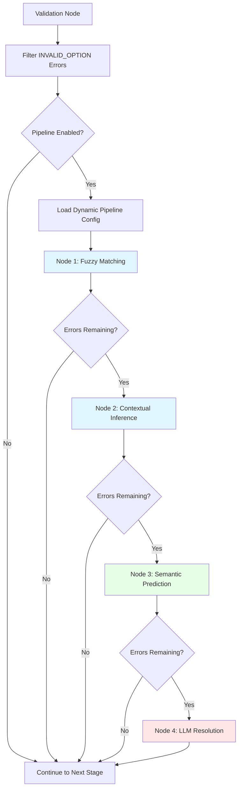

# Enum Correction Nodes Design

## Overview

This document describes the design and implementation of three new processing nodes for correcting INVALID_OPTION validation errors in the metadata harmonization processor. These nodes complement the existing semantic prediction node by providing additional correction strategies using fuzzy matching, contextual inference, and LLM-based reasoning.

## Architecture

### Pipeline Flow

The enum correction pipeline processes INVALID_OPTION errors through a configurable sequence of nodes:



### Processing Logic

Each node in the pipeline:
1. Receives validation errors from the previous stage
2. Processes **only errors without recommendations** (recommended_value is None)
3. Calculates a confidence score for each recommendation
4. Applies recommendation **only if confidence ≥ configured threshold**
5. Passes remaining unresolved errors to the next node

### Dynamic Node Ordering

The pipeline supports dynamic ordering through configuration:

```yaml
enum_correction_pipeline:
  enabled: true
  nodes:
    - name: "fuzzy_matching"
      enabled: true
    - name: "contextual_inference"
      enabled: true
    - name: "semantic_prediction"
      enabled: true
    - name: "llm_resolution"
      enabled: true
```

Users can:
- Reorder nodes to optimize for their specific data patterns
- Disable expensive nodes (e.g., LLM) to reduce costs
- Enable only fast local nodes for performance-critical applications

## Node Specifications

### 1. Fuzzy Matching Node

**Purpose:** Detect and correct typographical errors using string similarity.

**Algorithm:** Levenshtein Distance
- Calculates edit distance between invalid value and each valid option
- Normalizes similarity score: `similarity = 1 - (edit_distance / max_length)`
- Recommends closest match if similarity ≥ threshold

**Configuration:**
```yaml
fuzzy_matching:
  min_similarity_threshold: 0.85  # 85% similarity required
  max_concurrent_predictions: 50
```

**Example Corrections:**
- "calfornia" → "california" (similarity: 0.90)
- "massachusets" → "massachusetts" (similarity: 0.92)
- "Nwe York" → "New York" (similarity: 0.88)

**Complexity:** O(n × m) where n = length of invalid value, m = number of valid options

**Performance:** Very fast, no external API calls, typically <1ms per correction

---

### 2. Contextual Inference Node

**Purpose:** Infer correct values based on dataset patterns and row similarity.

**Algorithm:** k-Nearest Neighbors with TF-IDF and Co-occurrence Analysis

**Process:**
1. **Schema-Based Column Detection:**
   - Automatically detects column types from JSON schema
   - Text columns: `type: "string"` without enum → TF-IDF vectorization
   - Categorical columns: `type: "string"` with enum → One-hot encoding
   - Numeric columns: `type: "integer"` or `type: "number"` → Standardization

2. **Feature Vector Construction:**
   - Text: TF-IDF with max_features=50, stop_words='english'
   - Categorical: One-hot encoding (handle_unknown='ignore')
   - Numeric: StandardScaler (mean=0, std=1)
   - Concatenate all features into single vector per row

3. **k-Nearest Neighbors:**
   - Calculate cosine similarity between query row and all reference rows
   - Select k most similar rows (default k=5)
   - Weight recommendations by similarity scores

4. **Co-occurrence Analysis:**
   - Calculate Pointwise Mutual Information (PMI) for feature-enum pairs
   - PMI = log(P(enum, feature) / (P(enum) × P(feature)))
   - Boost recommendations that frequently co-occur with row features

5. **Score Combination:**
   - Final score = (0.6 × similarity_score) + (0.4 × cooccurrence_score)
   - Recommend highest-scoring option if score ≥ threshold

**Configuration:**
```yaml
contextual_inference:
  k_neighbors: 5
  similarity_weight: 0.6
  cooccurrence_weight: 0.4
  min_confidence_threshold: 0.70
  max_concurrent_predictions: 50
```

**Example Use Case:**
```
Row context:
  product: "OnePlus 11"
  description: "flagship android smartphone"
  price_range: "high"
  brand_tier: "standard"

Invalid value: "unknown" (in category column)

K-nearest neighbors found:
  1. Google Pixel 7 (category: smartphone, similarity: 0.85)
  2. Samsung Galaxy S23 (category: smartphone, similarity: 0.82)
  3. Surface Pro 9 (category: tablet, similarity: 0.65)

Co-occurrence scores:
  smartphone + [android, high_price] = high PMI
  tablet + [android, high_price] = medium PMI

Recommendation: "smartphone" (confidence: 0.78)
```

**Schema Integration:**
```python
# Automatically detects column types from schema
properties = schema.get('properties', {})
for column_name, column_schema in properties.items():
    column_type = column_schema.get('type')
    has_enum = 'enum' in column_schema

    if column_type == 'string':
        if has_enum:
            categorical_columns.append(column_name)
        else:
            text_columns.append(column_name)
    elif column_type in ['integer', 'number']:
        numeric_columns.append(column_name)
```

**Complexity:** O(n × d) for feature building + O(k × n) for k-NN where n = rows, d = feature dimension, k = neighbors

**Performance:** Medium, all computation local, typically 10-50ms per correction depending on dataset size

---

### 3. Semantic Prediction Node (Existing - Enhanced)

**Purpose:** Find semantically similar valid options using embeddings.

**Algorithm:** Cosine Similarity on Embeddings
- Existing node enhanced with configurable embedding model
- Generates embeddings for invalid value and all valid options
- Calculates cosine similarity
- Recommends best match if similarity ≥ threshold

**Enhanced Configuration:**
```yaml
semantic_prediction:
  max_concurrent_predictions: 50
  cosine_similarity_threshold: 0.8
  embedding_model: "amazon.titan-embed-text-v2:0"  # NEW
  embedding_provider: "bedrock"  # bedrock or sagemaker
```

**Key Changes:**
- Added `embedding_model` configuration to specify which model to use
- Supports both Bedrock and SageMaker embedding providers
- Maintains existing caching strategy (Redis/in-memory)

---

### 4. LLM Resolution Node (NEW)

**Purpose:** Fallback layer using LLM reasoning for complex/ambiguous cases.

**Algorithm:** Strands Agent with Structured Prompting

**Process:**
1. For each unresolved INVALID_OPTION error:
   - Build structured prompt with row context
   - Invoke Strands agent with valid options
   - Parse LLM response for recommendation and confidence level
2. Apply recommendation if confidence level ≥ configured minimum

**Configuration:**
```yaml
llm_resolution:
  model_id: "amazon.nova-pro-v1:0"
  aws_region: "us-east-1"
  temperature: 0.3
  max_tokens: 500
  timeout_seconds: 30
  min_confidence_level: "medium"  # low, medium, or high
  max_concurrent_predictions: 10
  max_retries: 3
  use_strands_agent: true
```

**Confidence Level Mapping:**
- `low`: 0.5 threshold
- `medium`: 0.7 threshold
- `high`: 0.85 threshold

**Strands Agent Prompt Structure:**
```
You are helping correct invalid enum values in a metadata dataset.

Current invalid value: "{invalid_value}"
Valid options: {valid_option_1}, {valid_option_2}, ...

Row context:
{
  "column1": "value1",
  "column2": "value2",
  ...
}

Task: Select the most appropriate valid option and explain your confidence level.

Response format:
{
  "recommended_value": "<selected option>",
  "confidence_level": "<low|medium|high>",
  "reasoning": "<brief explanation>"
}
```

**Example Interaction:**
```json
// Prompt
{
  "invalid_value": "bay area",
  "valid_options": ["California", "New York", "Texas"],
  "row_context": {
    "organization": "Google",
    "city": "Mountain View",
    "zip_code": "94043"
  }
}

// LLM Response
{
  "recommended_value": "California",
  "confidence_level": "high",
  "reasoning": "Mountain View with zip code 94043 is located in California"
}
```

**Complexity:** O(1) per error but with high latency due to LLM API calls

**Performance:** Slowest node, ~500-2000ms per correction, highest API costs

**Fallback Strategy:**
- Only processes errors unresolved by previous nodes
- Typically handles <10% of initial errors
- Provides highest quality recommendations with reasoning

---

## Configuration Management

### Configuration Classes

**ProcessorConfig Extensions:**
```python
class NodeConfig(BaseSettings):
    """Configuration for a single processing node."""
    name: str
    enabled: bool = True

class EnumCorrectionPipelineConfig(BaseSettings):
    """Configuration for enum correction pipeline."""
    enabled: bool = True
    nodes: List[NodeConfig] = [
        NodeConfig(name="fuzzy_matching", enabled=True),
        NodeConfig(name="contextual_inference", enabled=True),
        NodeConfig(name="semantic_prediction", enabled=True),
        NodeConfig(name="llm_resolution", enabled=True)
    ]

class FuzzyMatchingConfig(BaseSettings):
    """Configuration for fuzzy matching node."""
    min_similarity_threshold: float = Field(default=0.85, ge=0.0, le=1.0)
    max_concurrent_predictions: int = Field(default=50, ge=1)

class ContextualInferenceConfig(BaseSettings):
    """Configuration for contextual inference node."""
    k_neighbors: int = Field(default=5, ge=1)
    similarity_weight: float = Field(default=0.6, ge=0.0, le=1.0)
    cooccurrence_weight: float = Field(default=0.4, ge=0.0, le=1.0)
    min_confidence_threshold: float = Field(default=0.70, ge=0.0, le=1.0)
    max_concurrent_predictions: int = Field(default=50, ge=1)

class LLMResolutionConfig(BaseSettings):
    """Configuration for LLM resolution node."""
    model_id: str = "amazon.nova-pro-v1:0"
    aws_region: str = "us-east-1"
    temperature: float = Field(default=0.3, ge=0.0, le=1.0)
    max_tokens: int = Field(default=500, ge=1)
    timeout_seconds: int = Field(default=30, ge=1)
    min_confidence_level: Literal["low", "medium", "high"] = "medium"
    max_concurrent_predictions: int = Field(default=10, ge=1)
    max_retries: int = Field(default=3, ge=1)
    use_strands_agent: bool = True
```

### Complete Configuration Example

```yaml
# Enum Correction Pipeline Configuration
enum_correction_pipeline:
  enabled: true
  nodes:
    - name: "fuzzy_matching"
      enabled: true
    - name: "contextual_inference"
      enabled: true
    - name: "semantic_prediction"
      enabled: true
    - name: "llm_resolution"
      enabled: true

# Node-Specific Configurations
fuzzy_matching:
  min_similarity_threshold: 0.85
  max_concurrent_predictions: 50

contextual_inference:
  k_neighbors: 5
  similarity_weight: 0.6
  cooccurrence_weight: 0.4
  min_confidence_threshold: 0.70
  max_concurrent_predictions: 50

semantic_prediction:
  max_concurrent_predictions: 50
  cosine_similarity_threshold: 0.8
  embedding_model: "amazon.titan-embed-text-v2:0"
  embedding_provider: "bedrock"

llm_resolution:
  model_id: "amazon.nova-pro-v1:0"
  aws_region: "us-east-1"
  temperature: 0.3
  max_tokens: 500
  timeout_seconds: 30
  min_confidence_level: "medium"
  max_concurrent_predictions: 10
  max_retries: 3
  use_strands_agent: true
```

## Implementation Details

### File Structure

```
projects/metadata-harmonization-processor/
├── design/
│   └── enum-correction-nodes.md          # This document
├── src/metadata_harmonization_processor/
│   ├── config.py                         # Updated with new config classes
│   ├── nodes/
│   │   ├── __init__.py
│   │   ├── fuzzy_matching.py             # NEW - FuzzyMatchingNode
│   │   ├── contextual_inference.py       # NEW - ContextualInferenceNode
│   │   ├── semantic_prediction.py        # UPDATED - Enhanced config
│   │   └── llm_resolution.py             # NEW - LLMResolutionNode
│   └── utils/
│       ├── fuzzy_utils.py                # NEW - Levenshtein helpers
│       └── tfidf_utils.py                # NEW - TF-IDF/k-NN helpers
├── config.yaml                           # Updated with pipeline config
└── tests/
    └── nodes/
        ├── test_fuzzy_matching.py
        ├── test_contextual_inference.py
        └── test_llm_resolution.py
```

### Node Registry Pattern

The orchestrator uses a registry pattern for dynamic node instantiation:

```python
# Node registry for dynamic pipeline construction
NODE_REGISTRY = {
    "fuzzy_matching": FuzzyMatchingNode,
    "contextual_inference": ContextualInferenceNode,
    "semantic_prediction": SemanticSearchPredictionNode,
    "llm_resolution": LLMResolutionNode
}

def build_enum_correction_pipeline(
    config: ProcessorConfig,
    state: ProcessorState
) -> List[MultiAgentBase]:
    """Build enum correction pipeline based on configuration."""
    pipeline = []

    for node_config in config.enum_correction_pipeline.nodes:
        if not node_config.enabled:
            continue

        node_class = NODE_REGISTRY[node_config.name]

        # ContextualInferenceNode needs dataset and schema
        if node_config.name == "contextual_inference":
            node = node_class(
                config=getattr(config, node_config.name),
                dataset=state.original_data,
                schema=state.schema
            )
        else:
            node = node_class(getattr(config, node_config.name))

        pipeline.append(node)

    return pipeline
```

### Pipeline Execution

```python
async def execute_enum_correction_pipeline(
    state: ProcessorState,
    pipeline: List[MultiAgentBase]
) -> None:
    """Execute enum correction pipeline nodes in sequence."""

    # Filter for INVALID_OPTION errors
    invalid_option_errors = [
        e for e in state.combined_results.validation_results.validation_results
        if e.error_type == ValidationErrorType.INVALID_OPTION
    ]

    logger.info(f"Starting enum correction pipeline with {len(invalid_option_errors)} errors")

    for node in pipeline:
        # Count unresolved errors
        unresolved = [e for e in invalid_option_errors if not e.recommended_value]

        if not unresolved:
            logger.info(f"All errors resolved, skipping {node.__class__.__name__}")
            break

        logger.info(f"Executing {node.__class__.__name__} on {len(unresolved)} unresolved errors")

        # Execute node
        result = await node.invoke_async(
            task="Process validation errors",
            invocation_state={"processor_state": state}
        )

        if result.status == Status.FAILED:
            logger.error(f"Node {node.__class__.__name__} failed: {result}")
            break

        # Log progress
        resolved = [e for e in invalid_option_errors if e.recommended_value]
        logger.info(f"After {node.__class__.__name__}: {len(resolved)}/{len(invalid_option_errors)} resolved")
```

## Testing Strategy

### Unit Tests

**FuzzyMatchingNode:**
- Test Levenshtein distance calculation
- Test similarity normalization
- Test threshold enforcement
- Test edge cases (empty strings, special characters)

**ContextualInferenceNode:**
- Test schema-based column detection
- Test feature vector construction
- Test k-NN similarity calculation
- Test co-occurrence PMI calculation
- Test score combination and weighting

**LLMResolutionNode:**
- Test Strands agent invocation
- Test prompt construction
- Test response parsing
- Test confidence level mapping
- Test retry logic

### Integration Tests

**Pipeline Ordering:**
- Test different node orderings
- Test with nodes enabled/disabled
- Test early termination when all errors resolved

**End-to-End:**
- Test full pipeline with synthetic dataset
- Measure correction rates per node
- Validate confidence score assignments
- Test with various schema types

## Performance Considerations

### Node Comparison

| Node | Avg Latency | API Costs | Accuracy | Best For |
|------|-------------|-----------|----------|----------|
| Fuzzy Matching | <1ms | None | ~70% | Typos, misspellings |
| Contextual Inference | 10-50ms | None | ~75% | Pattern-based data |
| Semantic Prediction | 50-200ms | Low (cached) | ~85% | Semantic similarity |
| LLM Resolution | 500-2000ms | High | ~95% | Complex reasoning |

### Optimization Strategies

**1. Cost-Optimized (Minimize API Costs):**
```yaml
enum_correction_pipeline:
  nodes:
    - name: "fuzzy_matching"
      enabled: true
    - name: "contextual_inference"
      enabled: true
    - name: "semantic_prediction"
      enabled: false  # Skip embeddings API
    - name: "llm_resolution"
      enabled: false  # Skip LLM API
```

**2. Speed-Optimized (Minimize Latency):**
```yaml
enum_correction_pipeline:
  nodes:
    - name: "fuzzy_matching"
      enabled: true
    - name: "semantic_prediction"
      enabled: true  # Faster than contextual if cached
    - name: "contextual_inference"
      enabled: false
    - name: "llm_resolution"
      enabled: false
```

**3. Quality-Optimized (Maximize Accuracy):**
```yaml
enum_correction_pipeline:
  nodes:
    - name: "llm_resolution"
      enabled: true  # Best quality first
    - name: "semantic_prediction"
      enabled: true
    - name: "fuzzy_matching"
      enabled: true
    - name: "contextual_inference"
      enabled: true
```

### Memory Considerations

**ContextualInferenceNode:**
- Stores feature vectors for entire dataset in memory
- Memory usage: ~(num_rows × feature_dim × 8 bytes)
- For 10K rows with 100 features: ~8MB
- For 100K rows with 100 features: ~80MB

**Optimization:**
- Consider batch processing for very large datasets
- Implement feature vector caching for repeated runs

## Migration Guide

### Enabling the New Pipeline

1. **Update config.yaml:**
```yaml
enum_correction_pipeline:
  enabled: true
  nodes:
    - name: "fuzzy_matching"
      enabled: true
    - name: "contextual_inference"
      enabled: true
    - name: "semantic_prediction"
      enabled: true
    - name: "llm_resolution"
      enabled: true
```

2. **Configure thresholds:**
```yaml
fuzzy_matching:
  min_similarity_threshold: 0.85  # Adjust based on data

contextual_inference:
  min_confidence_threshold: 0.70  # Lower for more corrections

llm_resolution:
  min_confidence_level: "medium"  # low/medium/high
```

3. **Test with sample data:**
- Start with pipeline disabled
- Enable one node at a time
- Monitor correction rates and confidence distributions
- Adjust thresholds based on results

### Gradual Rollout

**Phase 1:** Enable fuzzy matching only
```yaml
nodes:
  - name: "fuzzy_matching"
    enabled: true
  - name: "contextual_inference"
    enabled: false
  - name: "semantic_prediction"
    enabled: false
  - name: "llm_resolution"
    enabled: false
```

**Phase 2:** Add contextual inference
```yaml
nodes:
  - name: "fuzzy_matching"
    enabled: true
  - name: "contextual_inference"
    enabled: true
  - name: "semantic_prediction"
    enabled: false
  - name: "llm_resolution"
    enabled: false
```

**Phase 3:** Enable full pipeline
```yaml
nodes:
  - name: "fuzzy_matching"
    enabled: true
  - name: "contextual_inference"
    enabled: true
  - name: "semantic_prediction"
    enabled: true
  - name: "llm_resolution"
    enabled: true
```

## Monitoring and Metrics

### Per-Node Metrics

Track for each node:
- Errors processed
- Recommendations generated
- Average confidence score
- Execution time
- Success rate (recommendations accepted)

### Pipeline Metrics

Track overall:
- Total correction rate
- Corrections per node (stacked)
- Cost per correction
- Average latency
- Confidence distribution

### Logging Example

```python
logger.info(
    f"Pipeline Complete: "
    f"resolved={resolved_count}/{total_count} ({resolved_pct:.1f}%), "
    f"fuzzy={fuzzy_corrections}, "
    f"contextual={contextual_corrections}, "
    f"semantic={semantic_corrections}, "
    f"llm={llm_corrections}, "
    f"total_time={elapsed_time:.2f}s"
)
```

## Future Enhancements

1. **Hybrid Scoring:** Combine confidence scores from multiple nodes
2. **Active Learning:** Track correction acceptance rates to tune thresholds
3. **Column-Specific Models:** Train specialized models per enum column
4. **Ensemble Voting:** Use multiple nodes to vote on final recommendation
5. **Explanation Aggregation:** Combine reasoning from multiple nodes
6. **Batch Optimization:** Process similar errors together for efficiency

## Conclusion

This design provides a flexible, extensible framework for enum value correction with:
- Multiple correction strategies optimized for different error types
- Configurable pipeline ordering for different use cases
- Schema integration for automatic column type detection
- Confidence-based recommendation filtering
- Performance optimization options (cost vs. quality vs. speed)

The modular architecture allows users to customize the pipeline for their specific data characteristics and constraints.
